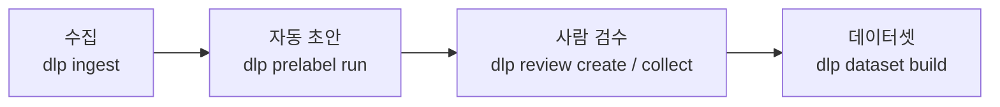
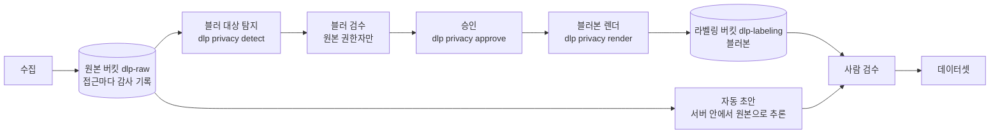
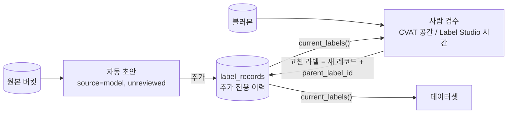
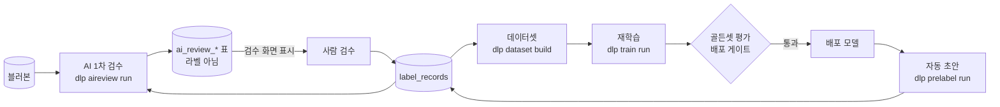
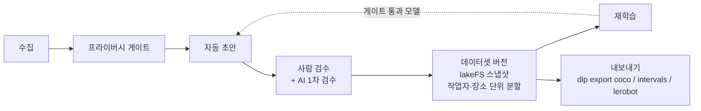

# data_labeling

1인칭 바디캠으로 찍은 돌봄·청소 영상에 라벨을 붙이는 Python CLI 플랫폼이다. 모델이 손·객체·도구·행동 라벨
초안을 만들고, 사람이 CVAT·Label Studio에서 고친 이력을 데이터셋 버전으로 남긴다. 사용자는 영상을 수집하는
운영자, 라벨을 고치는 검수자, 그 데이터로 사내 모델을 학습하는 개발자다.

얼굴·화면 같은 개인정보는 사람이 승인한 블러본으로만 다음 단계에 넘긴다. 라벨은 덮어쓰지 않고 새 레코드를
추가한다. 이 두 가지가 구조 대부분을 정한다.

현재는 단일 환경의 청소 영상 파일럿을 준비한 단계다. 재학습기는 객체 과제의 YOLOX만 실제 학습기이고 나머지는
모의 구현(`oracle-stub`)이다. 다중 고객 운영의 인증·격리·복구와 미해결 의존성 취약점은
[남은 과제](docs/handover/known-issues.md)에 있다.

## 문서 지도

| 하고 싶은 일 | 읽을 문서 |
| --- | --- |
| 구조를 한눈에 보기 | 이 문서의 [어떻게 동작하나](#어떻게-동작하나) |
| 인수인계 받기, 기능 상태 확인 | [인수인계 첫 화면](docs/handover/README.md) |
| 패키지 상세, 의존 표, 용어 전체 | [구조 지도](docs/handover/architecture.md) |
| 다른 컴퓨터에 설치·검사 | [환경 준비](docs/handover/development.md) |
| 코드 수정, 장애 복구 | [변경 및 복구 안내](docs/handover/change-guide.md) |
| 터미널 없이 브라우저로 운영 | [운영 안내서](docs/handover/operator-guide.md) |
| 실제 촬영 영상으로 시험 | [청소 영상 파일럿](docs/weekend-video-pilot.md) |
| 개발 규칙, 요구사항, 결정 이유 | [CLAUDE.md](CLAUDE.md), [제품 계획](docs/labeling-platform-plan.md), [구현 계획](docs/ai-implementation-plan.md), [ADR 목록](docs/adr/README.md) |

## 어떻게 동작하나

그림 다섯 장으로 시스템을 조금씩 쌓는다. 각 그림은 앞 그림에 한 부분을 더한다.

### 1. 큰 흐름은 네 칸이다

영상을 받아 모델이 초안을 만들고, 사람이 고치고, 데이터셋으로 묶는다.



모든 단계는 `dlp <단계>` 하위 명령이다. 운영자가 세션 하나씩 순서대로 실행한다. 같은 명령을 다시 돌려도
결과가 같다(멱등). 진입점은 `packages/cli/src/dlp_cli/main.py`이고, 단계마다 `<단계>_cmds.py`가 정책 파일·저장소·DB를
엮어 각 패키지의 실행 함수를 부른다.

수집(`dlp ingest`)은 원본 영상을 바꾸지 않고 저장하며 PTS 인덱스와 프록시를 만든다. 바디캠이 마스터
타임라인이다. 다른 스트림(장갑 센서 등)은 `dlp sync run`이 오프셋·드리프트를 맞춘다.

### 2. 사람 눈을 거친 블러본만 다음 단계로 간다

원본에는 얼굴·화면 같은 개인정보가 있다. 그래서 수집과 초안 사이에 프라이버시 게이트가 있다.



원본 버킷은 `dlp_cli.raw_access.raw_store`로만 연다. 이 함수는 모든 접근을 `raw_access_log` 표에 남긴다.
일반 검수자, 행동 분류 VLM, AI 1차 검수, 학습, 내보내기는 블러본만 받는다. 블러본을 쓰는 단계는
`dlp_privacy.rendering.assert_render_current`로 렌더 해시가 지금 승인과 맞는지 확인한다. 검수 중 블러가 바뀌면
승인이 풀리고, 이미 나간 라벨링 작업은 회수된다.

자동 초안은 서버 안에서 원본으로 추론한다. 사람에게 보여 주지 않으므로 허용된다. 세션 상태(lifecycle)는
승인 뒤에 돌려야 `prelabeled`로 올라간다.

### 3. 라벨은 덮어쓰지 않고 이력으로 쌓는다

모델 라벨과 사람 라벨은 같은 `LabelRecord` 한 종류다(`packages/schema/src/dlp_schema/labels.py`). 모두
`label_records` 표에 추가만 한다.



검수 결과를 받으면(`dlp review collect`) `dlp_review.reconcile`이 라벨마다 네 가지로 나눈다.

- 바뀌지 않음: 원래 레코드의 검수 상태를 `human_approved`로 바꾼다. DB가 수정을 허용하는 열은 검수 상태 셋뿐이다.
- 바뀜: `parent_label_id`가 원래 레코드를 가리키는 사람 레코드를 새로 넣는다(`human_corrected`).
- 지움: 원래 내용을 복사하고 `retracted=True`인 레코드를 넣는다.
- 새로 그림: parent 없는 사람 레코드를 넣는다.

다른 단계는 `dlp_schema.episode.current_labels()`로 "지금 유효한 라벨"(운영 라벨)만 읽는다. 모델 버전이
바뀌어 다시 돌리면 검수 전인 이전 버전 라벨만 `retractions()`로 지운다. 사람이 승인·수정·표본 검증한 라벨은
어떤 단계도 지우지 못한다. PostgreSQL 트리거와 `dlp_schema.label_validation`이 이 규칙을 강제한다.

검수가 다 끝나면 `dlp review verify`가 세션을 `human_verified`로 올린다.

### 4. AI 1차 검수는 참고용이고, 검수 결과가 다음 모델을 만든다

두 개의 고리가 붙는다. AI 1차 검수는 사내 VLM이 초안을 먼저 보고 의심 구간을 표시한다. 재학습은 검수된
데이터로 모델을 다시 학습해 다음 초안에 쓴다.



AI 판정은 `ai_review_*` 표 다섯 개에만 쓴다. `label_records`나 검수 상태는 건드리지 않는다. 판정은 검수
우선순위를 올리거나 메모를 다는 데만 쓰고, 사람 검수나 표본을 줄이지 않는다. AI 제안은 검수자가 명시적으로
"적용"할 때만 사람 라벨이 된다(`dlp_review.ai_collect`). 판정 서버는 사내 서버만 쓴다.

재학습(`dlp train run <과제> <데이터셋 버전>`)은 데이터셋 버전의 학습·검증 분할에서만 예제를 뽑는다
(`dlp_train.extract`). 후보 모델은 골든셋으로 평가하고(예측은 DB에 쓰지 않는다), `dlp_eval.gate`를 통과해야
배포된다. 배포 모델은 다음 `dlp prelabel run`부터 쓰인다(`dlp_train.deployed`).

### 5. 내보내기는 데이터셋 버전에서, 블러본으로만 만든다

마지막 칸을 더하면 전체 그림이 된다.



`dlp dataset build`는 `dlp_datasets.splitter`로 세션을 golden·train·val·holdout으로 나눈다. 같은 작업자나 장소가
두 분할에 걸치지 않게 작업자·장소 단위로 나눈다. 스냅샷은 lakeFS에 커밋한다.

`dlp export <형식> <데이터셋 버전>`은 기본으로 사람이 만들거나 승인·수정·표본 검증한 라벨만 넣는다. 미검수
라벨은 `--include-unreviewed`를 줄 때만 넣는다. 블러 라벨, 원본 위치, 검수자 ID는 어떤 형식에도 넣지 않는다.
작업자 가명은 내보내기마다 다르게 만든다.

### 세션 상태는 한 방향으로 한 칸씩 간다

세션의 lifecycle은 아래 순서로만 올라간다. 어디서든 `withdrawn`(사용 중지)으로 갈 수 있고 되돌릴 수 없다.

```text
raw_ingested → privacy_approved → prelabeled → human_verified → split_assigned → exported
```

프라이버시 상태 `pending → auto_blurred → approved`는 따로 움직인다. 블러를 고치면 프라이버시 상태만
`auto_blurred`로 내려가고 lifecycle은 그대로다. 상태 경계와 저장 위치는
[구조 지도의 "상태와 시간의 경계"](docs/handover/architecture.md#상태와-시간의-경계)에 있다.

## 처음 돌려 보기

이 절을 따라 하면 개발 서비스를 띄우고, 전체 검사를 통과시키고, 합성 데이터를 만들고, 운영 콘솔을 연다.
실제 영상 세션은 다루지 않는다. 실제 영상은 [청소 영상 파일럿](docs/weekend-video-pilot.md)을 따른다.

준비물은 Python 3.12, uv, make, Git, Docker와 Compose v2, FFmpeg와 ffprobe, MediaPipe용 EGL·GLES다.
모든 명령은 저장소 루트에서 실행한다. 모델·검수 계정·MongoDB까지 포함한 전체 순서는
[환경 준비](docs/handover/development.md)에 있다.

1. 의존성을 설치한다. 전체 타입 검사에 FiftyOne이 필요하므로 큐레이션 그룹까지 받는다.

   ```bash
   make install-curation
   ```

   `make install`을 다시 돌리면 큐레이션 그룹이 빠진다.

2. `.env`를 만들고 셸에 읽어 들인다. `make env`는 `.env`가 없을 때만 `.env.example`을 복사한다.

   ```bash
   make env
   # .env의 포트·개발 계정·저장소 설정을 확인한다
   set -a
   . ./.env
   set +a
   ```

3. 개발 서비스를 띄우고, DB 마이그레이션과 온톨로지 v1 등록을 한 뒤, 서비스가 응답하는지 확인한다. 처음
   `make up`은 이미지를 받느라 몇 분 걸린다. `make health`가 서비스마다 `[OK  ]` 한 줄을 출력하면 된다.

   ```bash
   make up
   make db-upgrade
   make health
   ```

4. 린트, 포맷 검사, 타입 검사, 계약 검사, 단위 테스트를 한 번에 돌린다. PR 전에 반드시 통과해야 한다.

   ```bash
   make check
   ```

   `make check`는 서비스·격리 환경 테스트를 빼고 돈다. 실행 중인 서비스 대상 테스트는 `make test-services`다.

5. 정답을 아는 합성 데이터를 만든다. `sessions`, `sync`, `blur`, `actions`, `wiping` 경로가 한 줄씩 출력된다.

   ```bash
   make fixtures
   ```

   결과는 `data/fixtures/`에 생기며 저장소에는 넣지 않는다. 알고리즘 테스트는 이 정답으로 판정한다.

6. 브라우저 운영 콘솔을 연다. 출력된 토큰 주소(기본 127.0.0.1:8090)를 브라우저에 붙인다.

   ```bash
   uv run dlp console serve
   ```

여기까지 하면 개발 환경이 준비된다. 실제 모델 가중치는 `make models`로 받는다. CVAT는 `make up`에 없으므로
`make cvat-up`으로 따로 띄운다. 새 컴퓨터에 처음부터 설치할 때는 `scripts/install/install.sh`가 위 순서를
대신 돈다(Mac·Linux·WSL2).

세션 하나를 끝까지 돌리는 명령 순서는 다음과 같다. `<세션>`은 수집 때 출력되는 세션 ID다.

```bash
uv run dlp ingest <매니페스트>
uv run dlp sync run <세션>
uv run dlp privacy detect <세션>
uv run dlp review create <세션> --stage privacy   # 원본 권한자가 CVAT에서 블러 검수
uv run dlp review collect <작업 키>
uv run dlp privacy approve <세션>
uv run dlp privacy render <세션>
uv run dlp prelabel run <세션>
uv run dlp relations run <세션>
uv run dlp actions run <세션>
uv run dlp aireview run <세션>                    # 선택, 사내 VLM 필요
uv run dlp review create <세션> --stage labeling
uv run dlp review collect <작업 키>
uv run dlp review verify <세션>
uv run dlp dataset build <데이터셋 버전>
uv run dlp export coco <데이터셋 버전>
```

실제 파일럿 전에는 `uv run dlp pilot check`로 모델·도구·검수 계정 준비를 확인한다.

## 어디에 무엇이 있나

### 패키지

모든 패키지는 `packages/<이름>/src/<모듈>/`에 있다. 정책 파일은 `config/policies/`에 있다.

| 패키지 (모듈) | 역할 | 진입 명령 | 정책 파일 |
| --- | --- | --- | --- |
| `cli` (`dlp_cli`) | `dlp` 진입점, 단계 연결 | `dlp --help` | `config/defaults.yaml` |
| `schema` (`dlp_schema`) | 계약 타입, 온톨로지, DB 표·마이그레이션·저장소 | `dlp ontology register` | `config/ontology/` |
| `fixtures` (`dlp_fixtures`) | 정답을 아는 합성 데이터 | `dlp fixtures generate` | 없음 |
| `media` (`dlp_media`) | 수집, PTS 인덱스, 프록시, 카메라 내부 파라미터 | `dlp ingest`, `dlp media prepare`, `dlp calib` | `media.yaml`, `calibration.yaml` |
| `sync` (`dlp_sync`) | 멀티스트림 동기화 | `dlp sync run`, `dlp sync adjust` | `sync.yaml` |
| `privacy` (`dlp_privacy`) | 블러 탐지·승인·렌더·보류 | `dlp privacy detect`, `approve`, `render`, `hold` | `privacy.yaml` |
| `prelabel` (`dlp_prelabel`) | 손·객체·도구·자세·3D 자동 초안 | `dlp prelabel run` | `prelabel.yaml` |
| `relations` (`dlp_relations`) | 규칙으로 관계·접촉·커버리지 도출 | `dlp relations run` | `relations.yaml` |
| `actions` (`dlp_actions`) | 행동 구간·설명, 영어 번역 | `dlp actions run`, `dlp translate run` | `actions.yaml`, `translate.yaml` |
| `aireview` (`dlp_aireview`) | AI 1차 검수 판정(참고용) | `dlp aireview run`, `status`, `show` | `aireview.yaml` |
| `review` (`dlp_review`) | CVAT·Label Studio 작업, 수집, 검수 운영 | `dlp review create`, `collect`, `verify`, `plan` | `review.yaml`, `config/review_ui.yaml` |
| `datasets` (`dlp_datasets`) | 데이터셋 버전, 분할, 골든셋, 사용 중지 | `dlp dataset build`, `golden`, `withdraw` | `dataset.yaml` |
| `models` (`dlp_models`) | 모델 레지스트리, ONNX 런타임 | `dlp models fetch`, `licenses` | `config/models.yaml` |
| `training` (`dlp_train`) | 재학습 루프, 배포 승인 | `dlp train run`, `models`, `approve` | `training.yaml` |
| `evaluation` (`dlp_eval`) | 지표, 골든셋 평가, 배포 게이트 | `dlp eval golden` | `evaluation.yaml` |
| `active` (`dlp_active`) | 액티브 러닝 점수, FiftyOne 연동 | `dlp active rank` | `active.yaml` |
| `retarget` (`dlp_retarget`) | 고객 로봇 리타기팅 | `dlp robot check`, `dlp export lerobot --robot` | `retarget.yaml` |
| `export` (`dlp_export`) | COCO·구간 JSON·LeRobot 내보내기 | `dlp export coco`, `intervals`, `lerobot` | `export.yaml` |
| `ops` (`dlp_ops`) | 주간 지표, 원본 접근 감사, 보관 만료 | `dlp ops weekly`, `audit-report`, `retention` | `ops.yaml` |
| `console` (`dlp_console`) | 브라우저 운영 콘솔(도메인 로직 없음) | `dlp console serve` | `config/console.yaml` |

패키지 사이 import 허용 범위는 [구조 지도의 의존 표](docs/handover/architecture.md#실제-의존-관계)에 있고,
`tests/test_import_boundaries.py`가 실제 import와 대조한다. 그 밖의 디렉터리는 다음과 같다.

- `config/`: 온톨로지, 정책, 기본값 YAML. 코드에 값을 하드코딩하지 않는다.
- `schemas/`: 생성된 JSON Schema. 직접 고치지 않고 `make schemas`로 만든다.
- `services/`: 개발용 docker compose와 CVAT 실행 스크립트.
- `tests/`: 패키지를 가로지르는 통합 테스트.
- `docs/adr/`: 아키텍처 결정 기록.

### 서비스와 포트

아래는 개발 기본값이며 `.env`로 바꾼다. 헬스체크 통과는 인증·계정·실제 기능이 준비됐다는 뜻이 아니다.
CVAT와 외부 큐레이션 MongoDB는 `make up`에 들어 있지 않다.

| 서비스 | 기본 주소 | 용도 |
| --- | --- | --- |
| PostgreSQL | localhost:5432 | 세션·라벨 이력·검수·감사 등 모든 상태 |
| SeaweedFS S3 | http://localhost:8333 | 버킷 `dlp-raw`, `dlp-labeling`, `dlp-datasets`, `dlp-mlflow` |
| Label Studio | http://localhost:8081 | 시간 라벨 검수. `make up`이 서비스 API 토큰을 켠다 |
| Prefect | http://localhost:4200 | 전체 CLI 자동 재개 큐는 미구현 |
| MLflow | http://localhost:5000 | 학습 기록. 산출물은 `dlp-mlflow` |
| lakeFS | http://localhost:8000 | 데이터셋 버전 스냅샷 |
| CVAT | http://localhost:8080 | 공간 라벨·블러 검수. `make cvat-up`으로 따로 띄운다 |
| MongoDB | localhost:27017 | 선택 큐레이션(FiftyOne)의 외부 DB. 따로 준비한다 |

TLS 프록시 뒤에서 MLflow 이미지 빌드에 추가 CA가 필요하면 빌드 시크릿으로 넘긴다. 인증서 검증은 끄지 않는다.

```bash
docker build --secret id=extra_ca,src=/path/to/ca-bundle.crt -t dlp-mlflow:3.16.1 services/mlflow
```

`make` 대상 전체(검사, 포맷, 스키마 재생성, 라이선스 표, 통합 테스트 등)는 [CLAUDE.md "명령어"](CLAUDE.md#명령어)에 있다.

### 용어

처음 막히기 쉬운 말만 모았다. 전체 정의는 [구조 지도의 "용어"](docs/handover/architecture.md#용어)에 있다.

| 용어 | 뜻 |
| --- | --- |
| 세션 | 작업자 한 명이 한 장소에서 찍은 촬영 한 번. 바디캠 스트림 하나와 센서 스트림을 묶는다 |
| 마스터 타임라인 | 바디캠 시계. 시간 라벨(행동·접촉)은 이 시각, 공간 라벨은 그 스트림의 PTS 시각을 쓴다 |
| PTS | 영상 프레임의 표시 시각. 프레임 번호에 간격을 곱하지 않고 PTS 인덱스로만 시각을 계산한다 |
| 원본 버킷 | `dlp-raw`. 블러 전 영상과 파생물. 원본 권한자와 서버 안 추론만 감사 경로로 읽는다 |
| 블러본 | 승인된 블러 라벨로 렌더한 영상. `dlp-labeling`에 있고 일반 검수·학습·내보내기는 이것만 쓴다 |
| 프라이버시 게이트 | 탐지, 사람 블러 검수, 승인, 렌더. 이 문을 지나야 블러본이 생긴다 |
| 프리라벨 | 모델이 만든 라벨 초안. `source=model`, 검수 상태 `unreviewed`로 시작한다 |
| 라벨 레코드 | `label_records`의 한 행. 사람·모델·센서 라벨을 모두 담고 추가만 한다 |
| 운영 라벨 | `current_labels()`가 고르는 지금 유효한 라벨. 다른 단계·학습·내보내기의 입력 |
| 검수 상태 | `unreviewed`, `sample_verified`, `human_approved`, `human_corrected` 넷 |
| 표본 검증 | 높은 신뢰도 묶음의 일부만 사람이 보고, 결함률이 낮으면 나머지를 검증된 것으로 두는 것 |
| 물려받기 | 화면에서 직접 보지 않는 라벨(설명, 3D 궤적)이 출처 라벨의 검수 상태를 이어받는 것 |
| AI 1차 검수 판정 | 사내 VLM의 참고 의견. `ai_review_*` 표에만 있고 라벨도 검수 상태도 아니다 |
| 데이터셋 버전 | lakeFS 스냅샷과 분할 배정. 학습과 내보내기는 여기서만 시작한다 |
| 분할 | golden, train, val, holdout. 작업자·장소가 분할 사이에 겹치지 않는다 |

## 꼭 지킬 약속 5가지

어떤 변경도 아래를 어기면 안 된다. 원문은 [CLAUDE.md "규칙"](CLAUDE.md#규칙)이고, 어떤 규칙이 트리거·테스트로
막히는지는 [불변 조건과 강제 수단](docs/handover/invariants.md)에 있다.

1. **원본은 감사 경로로만, 사람은 승인된 블러본만 본다.** 원본 버킷은 `raw_store`로만 열고 접근은
   `raw_access_log`에 남는다. 일반 검수·내보내기 경로에 원본 URI를 노출하지 않는다(`dlp_review.roles.check_stage_uris`).
   블러는 사람이 검수·승인한 뒤에만 렌더한다. [ADR 0005](docs/adr/0005-privacy-gate.md),
   [ADR 0020](docs/adr/0020-ops-dashboard-and-security.md)
2. **라벨은 덮어쓰지 않는다.** 수정은 새 레코드와 `parent_label_id`로 남기고, 사람이 승인·수정·표본 검증한
   라벨은 어떤 단계도 지우지 않는다. [ADR 0002](docs/adr/0002-contracts-and-label-storage.md),
   [ADR 0015](docs/adr/0015-audit-fixes.md)
3. **모델마다 상업 사용 분류를 적는다.** `config/models.yaml`에 가중치 라이선스, 학습 데이터, `commercial`
   분류(`allowed`, `review`, `forbidden`)를 적는다. `forbidden` 가중치는 쓰지 않는다. `make licenses`가 검사한다.
   [ADR 0010](docs/adr/0010-model-commercial-use.md)
4. **분할은 작업자·장소 단위로 `dlp_datasets.splitter`만 만든다.** 골든·학습·검증 사이에 작업자나 장소가
   겹치면 안 된다. 학습 예제와 내보내기는 데이터셋 버전에서만 만든다.
   [ADR 0007](docs/adr/0007-datasets-and-lineage.md)
5. **AI 1차 검수는 참고용이다.** 판정은 `ai_review_*` 표에만 쓰고, 입력은 승인된 블러본(`open_blurred`)만,
   서버는 사내 서버만 쓴다. 사람 검수나 표본을 줄이지 않고, 검수자가 적용한 제안만 라벨이 된다.
   `tests/test_aireview_boundaries.py`가 경계를 검사한다. [ADR 0040](docs/adr/0040-ai-first-pass-review.md)

실제 영상, 동의 정보, 계정, 모델 가중치는 Git에 넣지 않는다. 테스트는 합성 픽스처로 쓴다.

## 다음에 읽을 것

1. [인수인계 첫 화면](docs/handover/README.md)의 "첫날 읽을 5개"
2. [구조 지도](docs/handover/architecture.md): 코드 읽는 순서, 의존 표, 패키지 상세
3. [변경 및 복구 안내](docs/handover/change-guide.md): 바꿀 때 함께 고칠 파일과 실패 복구
4. [알려진 문제 목록](docs/handover/issues.yaml)과 [인수 기준](docs/handover/acceptance.md)
5. 작업할 WP 절: [구현 계획](docs/ai-implementation-plan.md), 결정 이유는 [ADR 목록](docs/adr/README.md)
