# 전문가 인수인계: 여기서 시작

이 프로젝트는 바디캠 영상에서 자동 라벨 초안을 만들고, 사람의 수정 이력을 저장해 데이터셋을
만드는 Python CLI 플랫폼이다. 검수 화면은 CVAT·Label Studio를 사용한다. 현재 인수 범위는
**단일 운영 환경의 파일럿**이며, 여러 고객을 받는 SaaS의 인증·격리·운영 보장은 추가 구현이 필요하다.

**데이터 용도 (2026-10-24 사용자 결정):** 라벨링한 데이터는 당분간 판매하지 않고 **사내 모델 개발**에
쓴다. 이것은 문서상의 용도 변경일 뿐이다. 모델 상업 사용 분류(ADR 0010, `forbidden` 가중치 금지),
원본·개인정보 경계(ADR 0020·0021), 내보내기 규칙(블러본만·가명·검수 라벨 기본, ADR 0027)은 그대로
지킨다. 비상업 가중치는 사내 상업 제품 개발에도 일반적으로 허용되지 않으며, 개인정보 규칙은 용도와
관계없이 적용된다. 판매를 다시 시작할 때 바꿀 것은 없다 (같은 규칙으로 만들었다).

**운영자 화면 (ADR 0061):** 터미널 없이 브라우저에서 단계를 진행하는 운영 콘솔(`dlp console serve`)과
설치 스크립트(`scripts/install/install.sh`)가 있다. 비전공자용 안내는 [운영 안내서](operator-guide.md).

## 먼저 볼 지도

```mermaid
flowchart LR
    A[촬영 영상과 동의 정보] --> B[수집 / PTS / 동기화]
    B --> C[프라이버시 탐지]
    C --> D[권한자의 원본 전수 검수]
    D --> E[승인 / 블러 렌더]
    E --> F[손·객체·도구 초안]
    F --> F2[AI 1차 검수: 블러본, 참고용]
    F2 --> G[일반 검수자의 수정 / 수집]
    G --> H[검수 완료 판정]
    H --> I[데이터셋 버전 / 내보내기]
    I -. 학습 인터페이스 연결 .-> J[평가 / 모델 배포]
```

이 그림은 운영 순서다. 추론 단계가 모두 블러본을 읽는다는 뜻은 아니다. 서버 내 프리라벨은
감사 경로로 원본을 읽고, 일반 검수자·행동 VLM·큐레이션·내보내기는 승인된 블러본을 사용한다.
실제 재학습기는 아직 연결되지 않았다.

## 현재 상태: 2026-10-11 기준

| 영역 | 구현·확인된 범위 | 인수자가 추가 확인할 것 |
| --- | --- | --- |
| 영상 입력 | 회전 사본 준비, PTS 비교, 수집·프록시·동기화 | 실제 바디캠 코덱·센서 트랙·긴 영상 |
| 개인정보 처리 | 탐지·원본 전수 검수·승인·블러 렌더·해시 검사, 블러 변경 뒤 배포한 라벨링 매체 회수(ADR 0039) | 현장 누락률, OCR 미구현, CVAT 원본 사본 삭제, 회수 cron 운영 |
| 손·객체·도구 | 실제 모델 연결, CPU 합성 영상 실행 검사 | 실제 청소 영상의 정확도·수정시간·처리속도 |
| 전신·깊이·3D 관계 | 모델/규칙 경로 일부 구현, 합성 테스트. 손목·다섯 손가락 끝 3D(카메라 좌표)를 MediaPipe 손 중심 3D 점 + 2D 투영 + 손바닥 깊이·손 크기 사전값으로 맞춤(ADR 0044, 정답 3D 합성 픽스처 `dlp_fixtures.hand3d`로 흔들림 없음 1 mm·1 px 잡음 2 cm 안 검사), LeRobot state에 6점. 표본마다 방식(hand_fit·point_depth)과 맞춤 품질 신뢰도, 기기 내부 파라미터 등록(`dlp calib intrinsics|import`, 합성 체커보드로 fx 1% 안 복원), 작업자 손 크기(`dlp calib palm|palm-estimate`) (ADR 0045, 절차 [camera-calibration.md](camera-calibration.md)). 부분 수정 손 트랙은 고치지 않은 키프레임의 world 유지. 바디캠 6자유도 자세(내장 IMU 시각 오도메트리: 자이로 적분·가속도 중력 정렬 + 특징점·메트릭 깊이 이동, `dlp_prelabel.campose`)와 세션 월드 좌표 3D 궤적(`frame=world`, `derived_from`)을 `dlp prelabel run`이 만듦 (ADR 0046, 합성 정답 1.5 m 경로 ATE 2~4 mm, 추정기 단위에서 IMU 오프셋 효과 확인·러너는 IMU를 마스터 시각으로 바꿔 넘기는 배선만 SQLite로 확인). 2D 검수를 물려받기만 한 3D는 캘리브레이션·손 크기·정책이 바뀌면 다시 계산해 바꾸고, 되돌린 입력은 다시 만듦 (ADR 0051) | 깊이 모델은 이번 검사에서 생략; 실제 공간 보정과 품질 미입증; 실영상 손가락 끝 정확도·신뢰도 보정 미측정, 왜곡 계수 미적용(F-PAR-28); 자세·월드 좌표 실영상 정확도 미측정(F-PAR-29), 카메라-IMU 외부 파라미터는 매니페스트에 직접(F-PAR-30), 외부 SLAM 엔진(루프 닫힘) 미연동(F-PAR-31) |
| 사람 검수 | CVAT·Label Studio 수집, 이력, 완료 판정 | 실제 검수 사용성; 고객별 권한 체계 |
| 행동 분류 | 경계 후보와 외부 VLM 어댑터(공통 전송 `dlp_models.vlm`, 4xx는 종료 5), 모의 테스트 | 실제 VLM 서버; 배포된 행동 모델을 읽는 경로 |
| 한·영 라벨 (ADR 0043) | 온톨로지 v1 191개 항목(팔 관절 2개는 ADR 0058, 손 마스크 객체 hand는 ADR 0059)의 영어 이름(초안 덧붙이기, `make db-upgrade`로 재등록), 내보내기 한·영 이름(COCO·구간 JSON 1.1·LeRobot 어휘), 한국어 설명의 영어 번역 단계(`dlp translate run\|pending`, `dlp actions run` 뒤 자동, 원문 수정·버전 교체·검수 보호·서버 장애 대기), 설명이 행동 검수를 따름(승인·표본 검증 물려받기, 의미를 고쳤거나 일부·전부 지운 행동의 검수 전 설명 삭제, 3절, F-PAR-15·16 고침), 의미를 고친 행동의 설명 재생성(`dlp actions describe <세션>\|--pending`, 고친 행동 검수를 물려받음, F-PAR-18), 물려받은 뒤 행동이 다시 바뀌면 물려받은 설명도 지우고 다시 만듦(규칙 6, F-PAR-19). 물려받음은 명시 기록 `description_inheritance`(Alembic 0021, 이전 데이터는 예전 추정으로 한 번 백필)로 판정(F-PAR-20), 사람이 쓴 설명의 번역은 쓴 시각의 행동과 비교(F-PAR-22), 재생성 요청은 손마다 의미 필드 전부를 묶어 손 단위 검증(F-PAR-21), 재생성·번역의 쓰기 직전 사용 중지·보류·렌더 재확인(F-PAR-23). stub 번역기·`OracleVlm`·가짜 서버로 검사 | 실제 사내 서버의 번역·재생성 설명 품질(용어집 적중·한글 잔존), 구매자 문서의 형식 1.1 |
| AI 1차 검수 (WP17) | 결정(ADR 0040)·정책·후보 모델 라이선스 확인, 판정 핵심(계획·프롬프트·응답 재검사·제안·합성 오류 탐지 stub), 서버 점검·처리량 벤치·작업량 추정(`dlp aireview probe\|bench\|estimate`), 추가 전용 AI 표 5개·저장소(Alembic 0019), 실행기·블러본 경계·엔드포인트 묶음·차단기(`dlp aireview run\|status\|show\|waive`, `--pending`), 검수 화면 표시(Label Studio AI 구간·메모·요약·결정 단축키, CVAT 이슈, 노출 기록·대조군 0.1, `review.yaml ai_review` 저장소 값 advisory), 우선순위·표본 제외·표본 합격 뒤 재검수 보호, required 배정 게이트(`dlp review plan` 종료 6), 검수자가 명시적으로 고른 제안 적용(DB의 제안을 다시 검사, 세션 검증에 걸리면 AI 적용만 되돌림)과 결과 기록, 품질 지표(`dlp review quality --ai`: 대조군 기준·표본 가중 지적 정밀도·재현율·층화 ok 놓침률과 상한, `dlp ops weekly` AI 절·경고), 골든 평가(`dlp aireview eval`, DB에 쓰지 않음, 게이트는 경고만). 실제 서버 없이 가짜 서버·stub으로, 화면은 Label Studio 1.23.2·CVAT v2.78.0 실화면으로 검사 | DGX Spark 실측과 대수 결정([VLM 서버](vlm-server.md)), 실서버 골든 게이트·실세션 파일럿(대조군 지표), 파일럿 뒤 required 전환·게이트 차단 결정, 후속 F-AIR-* |
| 학습·배포 | 예제 추출·MLflow·평가 게이트·배포 흐름 | 학습기는 `oracle-stub`만 등록; 사람 수정 후 성능 향상 미입증 |
| 내보내기 | COCO·구간 JSON·LeRobot 경로, 게시 전 재검사. LeRobot 격리 환경 검사(사람·로봇 모드) 2026-10-17 통과 | 고객 전달 샘플 |
| 로봇 리타기팅 (ADR 0047) | 로봇 등록(`config/robots/<ID>.yaml`, 고객 것은 `DLP_ROBOTS_DIR`, 모델 sha256 확인), 공개 시험 로봇 SO-101(Apache-2.0 URDF), 손 → 끝단 목표·평행 그리퍼, 내장 감쇠 최소제곱 IK(관절·속도 한계)와 격리 환경 mink(MuJoCo) 풀이기, 프레임별 도달 표시·에피소드 보고(지어내지 않음), `dlp export lerobot --robot <ID>`(state = 로봇 관절, `retarget.*`, `meta/dlp_retarget.json`, manifest `robot`). 합성 정답에서 끝단 오차 0.1 mm 미만, 팔 길이 밖 구간 표시. SO-101은 full 모드(롤 포함), 재시작·그리퍼 속도 한계, 설정·URDF 검증, meta에 판정 기준(ADR 0053). 절차 [robot-retargeting.md](robot-retargeting.md) | 3D 궤적은 2D 손·박스 트랙 검수를 물려받고 끊기면 지운다, 카메라 자세는 자동 라벨(ADR 0048·0050, F-COE-19·21·22 고침), 다지 손(F-COE-17), 영상 속 사람 손(F-COE-18), 충돌·동역학·실물 검증(F-COE-20) |
| 3D 궤적 검수 물려받기 (ADR 0048·0050) | 깊이 3D가 `derived_from`=(2D 손 트랙 또는 박스 트랙)을 남기고(판 `+hf3`), 출처 2D가 사람이 확인한 상태면 카메라·월드 좌표 손 3D와 박스 중심 3D가 상태·검수자·시각을 물려받는다(`dlp_schema.trajectory_follow`, 추가 전용 `trajectory_inheritance`, Alembic 0023). 물려받기만 한 3D의 출처 2D가 바뀌면 궤적 따르기(`trajectory-follow-1`)가 지운다(저장 검증의 두 번째 좁은 예외, F-COE-22). 카메라 자세는 자동 라벨이라 `review.yaml verify.automatic`(기본 `[camera_pose]`)으로 완료 판정을 막지 않는다(F-COE-21). 수집·`dlp review verify`·`dlp prelabel run`에서 적용. 기본 내보내기에 들어가고 manifest `verification_policy.trajectory3d`에 근거(`camera_pose: automatic_unreviewed`, `pose_derived` 등)를 적는다 | 3D 값 자체의 표본 검증(재생 영상 판정) 없음, 같은 상태·검수자·시각 직접 재검수 구분 한계(F-PAR-25와 같음) |
| 객체 물리 사전값 (ADR 0049) | 온톨로지 객체의 선택 `physical_priors`(재질·촉감·질량 kg·정지 마찰 계수 범위, 상태별 `by_state`, 출처 `prior_estimate`·`prior_literature` 필수), 재질 10·촉감 11 어휘(`physics.yaml`, 용어집 밖), v1 객체 29개(person 제외)에 넓은 추정값. 내보내기에 `measured: false`로 실음(COCO 범주·최상위, 구간 JSON 1.2, LeRobot 어휘). 등록된 초안의 사전값 변경은 `dlp ontology register 1.0.0 --accept-physical-priors`로만(ADR 0053), 내용 해시가 바뀌어 AI 1차 검수 재판정·새 검수 프로젝트, 표 `content_sha256`, LeRobot 접촉 객체 클래스 특징 | 숫자 전문가 검토(F-SCH-16, 초안은 승인 등록으로 교체), 장면별 촉감 라벨·VLM 제안(F-SCH-14), 장갑 기반 파지력·질량 추정(F-SCH-15) |
| SaaS 운영 | 개발 서비스·감사·보관 명령 | 인증·테넌트 격리·영속 작업 큐·복구·부하 검증 |

현재 테스트 결과는 [남은 과제](known-issues.md), 확정·후보 문제의 단일 목록은 [레지스트리](issues.yaml)가 기준이다.
테스트 통과와 실영상 정확도·상용 서비스 준비 완료는 별개의 판단이다.

## 블러가 바뀐 뒤 라벨링 작업 회수와 재생성

승인 뒤 블러 재검수·재탐지·렌더 정책 변경으로 블러본이 바뀌면, 이미 배포한 라벨링 작업
(CVAT 워터마크 사본, Label Studio 서명 URL)은 그 커밋에서 회수 요청되고 커밋 뒤 끊긴다
([ADR 0039](../adr/0039-revoke-labeling-media-on-blur-change.md)).

1. 수집(웹훅 수집이면 `dlp review serve` 서버 로그)·탐지·렌더 출력의 회수 내용과 다시 만들 명령을
   본다. 대기가 남으면 종료 코드 4다. `dlp review revoke <세션>`으로 다시 실행한다
   (cron: `dlp review revoke --pending`, 10분마다. 미리보기는 `--pending --dry-run`).
   Label Studio 작업의 서명 URL은 `review.yaml media.signed_url_ttl_s`(기본 7일) 뒤 만료되므로
   `dlp review refresh-urls`도 cron으로 하루 한 번 돌린다 (열린 작업만 다시 서명, 실패하면 종료 코드 1).
2. 남은 블러 검수 → `dlp privacy approve` → `dlp privacy render`.
3. AI 1차 검수를 쓰면(`review.yaml ai_review.mode`가 off가 아님) 먼저 `dlp aireview run <세션>`: 이전
   판정은 렌더 해시가 달라 새 작업에 보이지 않는다 (ADR 0040 I10, 수집 출력의 안내에도 들어간다).
   그다음 출력된 배정마다 `dlp review assign <배정>`, 배정 없는 작업은
   `dlp review create <세션> --stage labeling --assignee <담당자> --stream <스트림> --tool <도구>`.
   출력을 놓쳤으면 `dlp review verify <세션>`이 다시 만들 배정·직접 작업 명령을 보인다.
4. 검수·수집 → 배정 완료 → `dlp review verify <세션>`.

배포 직후에는 렌더 해시가 없는 구 작업을 `dlp review revoke <세션> --dry-run --include-legacy`로
확인하고 필요하면 `--include-legacy`로 회수한다. 라벨러가 노출을 신고하면
`dlp privacy hold <세션> --reason <신고>`로 승인을 보류한다 (승인 해제·렌더 무효·배포된 라벨링 작업
전부 회수, 보류 중 승인·라벨링 작업 생성 거부). 블러 검수·수집 뒤 `--release --reason <조치>`로
해제하고 `dlp privacy approve` → `render`로 재승인한다 ([ADR 0042](../adr/0042-privacy-approval-hold.md)).
한 스트림·작업만 끊을 때는 `dlp review revoke <세션> --stream <스트림> --all --reason incident`(작업을
알면 `--task <작업 키> --reason incident`). DB 회수 밖의 노출(라벨러 자격 증명 교체, CVAT·Label Studio
내보내기 기록 확인, 내려받기 경로 차단)은 ADR 0039 "사고 대응" 절차이고 문서뿐이다. 운영 배포 전과
월간 감사 때 `dlp services check --security`로 라벨링 버킷 버전 관리 꺼짐과 라벨러 키 범위(라벨링
버킷 읽기만)를 확인한다 (F-REV-19). 작업 생성이 실패해 DB 기록 없이 남은 도구
작업·사본(고아)은 `dlp review revoke --orphans`로 보고, 확인한 뒤 `--orphans --apply`로 지운다
(이 플랫폼 이름 규칙에 맞고 나이 하한 `review.yaml orphans.min_age_s`가 지난 것만, F-REV-15).
세션을 사용 중지하면(`dlp dataset withdraw`) 그 세션의 배포된 라벨링 작업이 같은 커밋에서 회수
요청되고 명령이 커밋 뒤 회수를 실행한다 (대기가 남으면 4). 그 세션에는 새 검수 작업을 만들지 않는다
(F-REV-17). `privacy.yaml render` 절은 화질(crf)만 바꿔도
렌더 해시가 바뀌어 다시 렌더하는 세션의 라벨링 작업이 모두 회수되므로, 진행 중 라벨링이 없을 때
바꾼다.

## 읽는 순서와 문서의 책임

| 목적 | 문서 |
| --- | --- |
| 외주 검수·리팩토링의 범위·결과물 형식·인수 기준 | [인수 기준](acceptance.md), PR 양식(`.github/pull_request_template.md`) |
| 알려진 문제 전체(ID·상태·심각도·관련 파일·재현 테스트) | [레지스트리](issues.yaml), 재현은 `tests/test_known_defects.py` |
| 작업 규칙마다 실제로 막는 수단(트리거·테스트)과 문서뿐인 규칙 | [불변 조건과 강제 수단](invariants.md) |
| 2026-10-11 전 파일 전수 검수 결과 | [전수 검수 결과](full-review-2026-10-11.md) |
| 2026-10-12 최종 검수 결과 (중간 등급 수정·T4/T5·AI 1차 검수) | [최종 검수 결과](full-review-2026-10-12.md) |
| 2026-10-15 외부 검수(Codex) 재현 5건·테스트 환경·리팩토링 권고 | [외부 검수 재현](external-review-2026-10-15.md) |
| 코드를 어디서 읽을지, 상태·시간·원본 경계 | [구조 지도](architecture.md) |
| 새 개발 환경 재현, 현재 클라우드와의 차이 | [환경 준비](development.md) |
| VLM 서버(DGX Spark·vLLM) 띄우기, 처리량 실측·대수 결정, Arm64 점검 | [VLM 서버](vlm-server.md) |
| 변경할 파일·테스트, 실패·재시도·잠금 | [변경 및 복구 안내](change-guide.md) |
| 수정 우선순위·완료 기준·현재 검증 결과 | [남은 과제](known-issues.md) |
| 사람 검수→재학습→평가→배포의 실제 연결과 구조 결함 | [학습 루프 검사](training-loop-review.md) |
| 클래스·동작·작업 계층, 버전·의미 검증과 청소 확장 범위 | [온톨로지 구조 검사](ontology-structure-review.md) |
| 온톨로지 변경 위치·용어 기준 초안·현장 예시 작성법 | [온톨로지 검수 안내](../ontology-guide.md) |
| 주석과 구현의 불일치, 설명 수정 범위·검증 | [주석 집중 검수](comment-review.md) |
| 전체 소스·설정 검사 목록, 추가 정정·새 실행 결과 | [전체 파일 검사](full-comment-review.md), [파일별 목록](full-comment-review-files.csv)(2026-10-10 시점, 지금 범위는 `make review-scope`) |
| 실제 촬영 영상의 첫 실행 | [청소 영상 파일럿](../weekend-video-pilot.md) |
| 첫 실영상(iPhone 13 가사 영상) 단계별 결과·실행 시간·화각 판단·막힌 것 | [실영상 파일럿 2026-10-22](pilot-real-2026-10-22.md) |
| 바디캠 내부 파라미터·작업자 손 크기 등록 | [카메라 캘리브레이션](camera-calibration.md) |
| 촬영 조건(렌즈 고정·손떨림 보정 끔·60 fps·노출 잠금·장착 방향·시작 1초 정지·체커보드·IMU), 준비·수집 경고 | [촬영 가이드](capture-guide.md) |
| 정답 없는 품질 대리 지표 (`dlp ops quality-proxy`, 짧은 트랙·깜박임·모델 사이 불일치·손 3D 물리 위반) | [`dlp_eval.proxy`](../../packages/evaluation/src/dlp_eval/proxy.py), 기준 `evaluation.yaml proxy`, 파일럿 전후 값 [실영상 파일럿 10절](pilot-real-2026-10-22.md) |
| 장면별 도구 질의(`dlp prelabel run --scene`, 사내 VLM 장면 분류), 오탐 의심 힌트(`dlp review hints [--tta]`: 블러·객체 검수 화면 CVAT 이슈, 라벨은 그대로), TTA·학습 증강 공용 기하 변환 | [ADR 0055](../adr/0055-scene-vocabulary-false-positive-hints-and-tta.md), [`dlp_prelabel.scene`](../../packages/prelabel/src/dlp_prelabel/scene.py), [`dlp_privacy.hints`](../../packages/privacy/src/dlp_privacy/hints.py), [`dlp_review.object_hints`](../../packages/review/src/dlp_review/object_hints.py), [`dlp_media.geometry`](../../packages/media/src/dlp_media/geometry.py) |
| 시간 일관성(트랙 거르기·손 평활·끊김 채우기)과 손 3D 물리 제약 | [ADR 0054](../adr/0054-prelabel-temporal-consistency-and-hand-3d-constraints.md), `dlp_prelabel.temporal`·`constraints3d`, 정책 `prelabel.yaml` |
| 캘리브레이션 없는 세션의 손 크기 초점 거리 추정(출처 `estimated_hand_size`, 실영상에서 깊이 모델 화각 편향으로 틀려 기본 끔, F-PAR-65), 승인된 블러본 조각의 사내 VLM 확인 힌트(`dlp review hints --ai`) | [ADR 0056](../adr/0056-hand-size-focal-estimate-and-ai-crop-hints.md), [`dlp_prelabel.fov`](../../packages/prelabel/src/dlp_prelabel/fov.py), [`dlp_aireview.crops`](../../packages/aireview/src/dlp_aireview/crops.py) |
| 학습 증강(기하·광학·1인칭, 라벨 종류별 변환·뒤집기 손 좌우 교환, 학습·검증 분할 블러본만, 판매 내보내기 없음) | [ADR 0057](../adr/0057-training-data-augmentation.md), [`dlp_train.augment`](../../packages/training/src/dlp_train/augment.py), 정책 `training.yaml augmentation` |
| 착용자 팔 골격 arm3(손목 → 아래팔 → 팔꿈치, 손별, 팔꿈치 3D·아래팔 길이 제약)과 착용자 자신의 팔·몸통 박스·자세 억제(라벨로 만들지 않고 단계 요약에만, 프라이버시 블러와 무관) | [ADR 0058](../adr/0058-wearer-arm-skeleton-and-wearer-body-suppression.md), [`dlp_prelabel.arm`](../../packages/prelabel/src/dlp_prelabel/arm.py), [`dlp_prelabel.wearer_suppress`](../../packages/prelabel/src/dlp_prelabel/wearer_suppress.py), [`dlp_schema.wearer_body`](../../packages/schema/src/dlp_schema/wearer_body.py), 정책 `prelabel.yaml wearer_suppression`·`arm` |
| 객체·손 모양 마스크(SAM 2.1 tiny ONNX, 박스·손 트랙 프롬프트, 500 ms 간격 이미지 모드, 착용자 몸 박스 제외, 손 class `hand`), CVAT 모양 모드 마스크 무손실 왕복, COCO segmentation RLE, 미리보기 채움·윤곽 | [ADR 0059](../adr/0059-object-and-hand-shape-masks-sam2.md), [`dlp_prelabel.masks`](../../packages/prelabel/src/dlp_prelabel/masks.py), [`dlp_models.sam2`](../../packages/models/src/dlp_models/sam2.py), 정책 `prelabel.yaml masks`, 파일럿 [12절](pilot-real-2026-10-22.md) |
| 고객 로봇 등록·리타기팅 내보내기 | [로봇 리타기팅](robot-retargeting.md) |
| 작업 규칙·필수 검사 | [CLAUDE.md](../../CLAUDE.md) |
| 목표와 작업 패키지별 요구사항 | [제품 계획](../labeling-platform-plan.md), [구현 계획](../ai-implementation-plan.md) |
| 결정 이유와 과거 변경 | [ADR 색인](../adr/README.md) |

계획 문서는 요구사항, ADR은 결정 당시의 기록이다. 현재 구현 상태는 이 안내와 코드로 확인한다.
새 변경은 상태표·관련 과제·변경 안내를 함께 갱신한다. 환경별 로그와 보고서(`reports/`, Git 제외)는
보조 증거로 보관하고, 인수에 필요한 결론은 이 디렉터리에 남긴다.
