# 전문가 인수인계: 여기서 시작

이 프로젝트는 바디캠 영상에서 자동 라벨 초안을 만들고, 사람의 수정 이력을 저장해 데이터셋을
만드는 Python CLI 플랫폼이다. 검수 화면은 CVAT·Label Studio를 사용한다. 현재 인수 범위는
**단일 운영 환경의 파일럿**이며, 여러 고객을 받는 SaaS의 인증·격리·운영 보장은 추가 구현이 필요하다.

## 먼저 볼 지도

```mermaid
flowchart LR
    A[촬영 영상과 동의 정보] --> B[수집 / PTS / 동기화]
    B --> C[프라이버시 탐지]
    C --> D[권한자의 원본 전수 검수]
    D --> E[승인 / 블러 렌더]
    E --> F[손·객체·도구 초안]
    F --> G[일반 검수자의 수정 / 수집]
    G --> H[검수 완료 판정]
    H --> I[데이터셋 버전 / 내보내기]
    I -. 학습 인터페이스 연결 .-> J[평가 / 모델 배포]
```

이 그림은 운영 순서다. 추론 단계가 모두 블러본을 읽는다는 뜻은 아니다. 서버 내 프리라벨은
감사 경로로 원본을 읽고, 일반 검수자·행동 VLM·큐레이션·내보내기는 승인된 블러본을 사용한다.
실제 재학습기는 아직 연결되지 않았다.

## 현재 상태: 2026-10-11 기준

| 영역 | 구현·확인된 범위 | 인수자가 추가 확인할 것 |
| --- | --- | --- |
| 영상 입력 | 회전 사본 준비, PTS 비교, 수집·프록시·동기화 | 실제 바디캠 코덱·센서 트랙·긴 영상 |
| 개인정보 처리 | 탐지·원본 전수 검수·승인·블러 렌더·해시 검사, 블러 변경 뒤 배포한 라벨링 매체 회수(ADR 0039) | 현장 누락률, OCR 미구현, CVAT 원본 사본 삭제, 회수 cron 운영 |
| 손·객체·도구 | 실제 모델 연결, CPU 합성 영상 실행 검사 | 실제 청소 영상의 정확도·수정시간·처리속도 |
| 전신·깊이·3D 관계 | 모델/규칙 경로 일부 구현, 합성 테스트 | 깊이 모델은 이번 검사에서 생략; 실제 공간 보정과 품질 미입증 |
| 사람 검수 | CVAT·Label Studio 수집, 이력, 완료 판정 | 실제 검수 사용성; 고객별 권한 체계 |
| 행동 분류 | 경계 후보와 외부 VLM 어댑터(공통 전송 `dlp_models.vlm`, 4xx는 종료 5), 모의 테스트 | 실제 VLM 서버; 배포된 행동 모델을 읽는 경로 |
| AI 1차 검수 (WP17) | 결정(ADR 0040)·정책·후보 모델 라이선스 확인, 판정 핵심(계획·프롬프트·응답 재검사·제안·합성 오류 탐지 stub), 서버 점검·처리량 벤치·작업량 추정(`dlp aireview probe\|bench\|estimate`, 가짜 서버로만 검사), 추가 전용 AI 표 5개·저장소(Alembic 0019) | 실행기·검수 화면 표시·수집 적용(WP17.5~17.7), DGX Spark 실측과 대수 결정([VLM 서버](vlm-server.md)) |
| 학습·배포 | 예제 추출·MLflow·평가 게이트·배포 흐름 | 학습기는 `oracle-stub`만 등록; 사람 수정 후 성능 향상 미입증 |
| 내보내기 | COCO·구간 JSON·LeRobot 경로, 게시 전 재검사 | 이번 LeRobot 격리 환경 검사 미실행; 고객 전달 샘플 |
| SaaS 운영 | 개발 서비스·감사·보관 명령 | 인증·테넌트 격리·영속 작업 큐·복구·부하 검증 |

현재 테스트 결과는 [남은 과제](known-issues.md), 확정·후보 문제의 단일 목록은 [레지스트리](issues.yaml)가 기준이다.
테스트 통과와 실영상 정확도·상용 서비스 준비 완료는 별개의 판단이다.

## 블러가 바뀐 뒤 라벨링 작업 회수와 재생성

승인 뒤 블러 재검수·재탐지·렌더 정책 변경으로 블러본이 바뀌면, 이미 배포한 라벨링 작업
(CVAT 워터마크 사본, Label Studio 서명 URL)은 그 커밋에서 회수 요청되고 커밋 뒤 끊긴다
([ADR 0039](../adr/0039-revoke-labeling-media-on-blur-change.md)).

1. 수집(웹훅 수집이면 `dlp review serve` 서버 로그)·탐지·렌더 출력의 회수 내용과 다시 만들 명령을
   본다. 대기가 남으면 종료 코드 4다. `dlp review revoke <세션>`으로 다시 실행한다
   (cron: `dlp review revoke --pending`, 10분마다. 미리보기는 `--pending --dry-run`).
   Label Studio 작업의 서명 URL은 `review.yaml media.signed_url_ttl_s`(기본 7일) 뒤 만료되므로
   `dlp review refresh-urls`도 cron으로 하루 한 번 돌린다 (열린 작업만 다시 서명, 실패하면 종료 코드 1).
2. 남은 블러 검수 → `dlp privacy approve` → `dlp privacy render`.
3. 출력된 배정마다 `dlp review assign <배정>`, 배정 없는 작업은
   `dlp review create <세션> --stage labeling --assignee <담당자> --stream <스트림> --tool <도구>`.
   출력을 놓쳤으면 `dlp review verify <세션>`이 다시 만들 배정·직접 작업 명령을 보인다.
4. 검수·수집 → 배정 완료 → `dlp review verify <세션>`.

배포 직후에는 렌더 해시가 없는 구 작업을 `dlp review revoke <세션> --dry-run --include-legacy`로
확인하고 필요하면 `--include-legacy`로 회수한다. 라벨러가 노출을 신고하면
`dlp privacy hold <세션> --reason <신고>`로 승인을 보류한다 (승인 해제·렌더 무효·배포된 라벨링 작업
전부 회수, 보류 중 승인·라벨링 작업 생성 거부). 블러 검수·수집 뒤 `--release --reason <조치>`로
해제하고 `dlp privacy approve` → `render`로 재승인한다 ([ADR 0042](../adr/0042-privacy-approval-hold.md)).
한 스트림·작업만 끊을 때는 `dlp review revoke <세션> --stream <스트림> --all --reason incident`(작업을
알면 `--task <작업 키> --reason incident`). DB 회수 밖의 노출(라벨러 자격 증명 교체, CVAT·Label Studio
내보내기 기록 확인, 내려받기 경로 차단)은 ADR 0039 "사고 대응" 절차이고 문서뿐이다. 운영 배포 전과
월간 감사 때 `dlp services check --security`로 라벨링 버킷 버전 관리 꺼짐과 라벨러 키 범위(라벨링
버킷 읽기만)를 확인한다 (F-REV-19). 작업 생성이 실패해 DB 기록 없이 남은 도구
작업·사본(고아)은 `dlp review revoke --orphans`로 보고, 확인한 뒤 `--orphans --apply`로 지운다
(이 플랫폼 이름 규칙에 맞고 나이 하한 `review.yaml orphans.min_age_s`가 지난 것만, F-REV-15).
세션을 사용 중지하면(`dlp dataset withdraw`) 그 세션의 배포된 라벨링 작업이 같은 커밋에서 회수
요청되고 명령이 커밋 뒤 회수를 실행한다 (대기가 남으면 4). 그 세션에는 새 검수 작업을 만들지 않는다
(F-REV-17). `privacy.yaml render` 절은 화질(crf)만 바꿔도
렌더 해시가 바뀌어 다시 렌더하는 세션의 라벨링 작업이 모두 회수되므로, 진행 중 라벨링이 없을 때
바꾼다.

## 읽는 순서와 문서의 책임

| 목적 | 문서 |
| --- | --- |
| 외주 검수·리팩토링의 범위·결과물 형식·인수 기준 | [인수 기준](acceptance.md), PR 양식(`.github/pull_request_template.md`) |
| 알려진 문제 전체(ID·상태·심각도·관련 파일·재현 테스트) | [레지스트리](issues.yaml), 재현은 `tests/test_known_defects.py` |
| 작업 규칙마다 실제로 막는 수단(트리거·테스트)과 문서뿐인 규칙 | [불변 조건과 강제 수단](invariants.md) |
| 2026-10-11 전 파일 전수 검수 결과 | [전수 검수 결과](full-review-2026-10-11.md) |
| 코드를 어디서 읽을지, 상태·시간·원본 경계 | [구조 지도](architecture.md) |
| 새 개발 환경 재현, 현재 클라우드와의 차이 | [환경 준비](development.md) |
| VLM 서버(DGX Spark·vLLM) 띄우기, 처리량 실측·대수 결정, Arm64 점검 | [VLM 서버](vlm-server.md) |
| 변경할 파일·테스트, 실패·재시도·잠금 | [변경 및 복구 안내](change-guide.md) |
| 수정 우선순위·완료 기준·현재 검증 결과 | [남은 과제](known-issues.md) |
| 사람 검수→재학습→평가→배포의 실제 연결과 구조 결함 | [학습 루프 검사](training-loop-review.md) |
| 클래스·동작·작업 계층, 버전·의미 검증과 청소 확장 범위 | [온톨로지 구조 검사](ontology-structure-review.md) |
| 온톨로지 변경 위치·용어 기준 초안·현장 예시 작성법 | [온톨로지 검수 안내](../ontology-guide.md) |
| 주석과 구현의 불일치, 설명 수정 범위·검증 | [주석 집중 검수](comment-review.md) |
| 전체 소스·설정 검사 목록, 추가 정정·새 실행 결과 | [전체 파일 검사](full-comment-review.md), [파일별 목록](full-comment-review-files.csv)(2026-10-10 시점, 지금 범위는 `make review-scope`) |
| 실제 촬영 영상의 첫 실행 | [청소 영상 파일럿](../weekend-video-pilot.md) |
| 작업 규칙·필수 검사 | [CLAUDE.md](../../CLAUDE.md) |
| 목표와 작업 패키지별 요구사항 | [제품 계획](../labeling-platform-plan.md), [구현 계획](../ai-implementation-plan.md) |
| 결정 이유와 과거 변경 | [ADR 색인](../adr/README.md) |

계획 문서는 요구사항, ADR은 결정 당시의 기록이다. 현재 구현 상태는 이 안내와 코드로 확인한다.
새 변경은 상태표·관련 과제·변경 안내를 함께 갱신한다. 환경별 로그와 보고서(`reports/`, Git 제외)는
보조 증거로 보관하고, 인수에 필요한 결론은 이 디렉터리에 남긴다.
