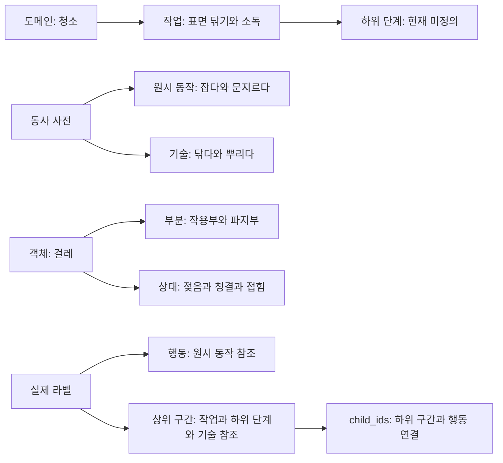

# 온톨로지 구조 검사

[인수인계 첫 화면](README.md) · [남은 과제](known-issues.md)

## 2026-10-11 개선 반영

아래는 10월 10일의 검사 기록이다. 이후 [ADR 0037](../adr/0037-ontology-validation-boundaries.md)에
따라 O1~O4의 저장·버전·구간·이관 검증을 보강했다. O5는 알려진 개체 클래스에 대한 DB 부분
검사와 명시적 개체 목록을 사용하는 `validate_episode`로 보강했다. 클래스 미확인 개체는
여전히 부분의 전체 ID만 확인한다. 테스트·운영 절차·잔여 과제는 [검수 안내](../ontology-guide.md)와
[남은 과제](known-issues.md)를 기준으로 본다.

사전 내용·청소 하위 단계·실제 영상 용어 확정·학습기 연결은 이번 변경에 포함하지 않았다.

## 최초 검사 기록

기준일: **2026-10-10**. 온톨로지 YAML 8개, 계약·검증·이관·DB 저장·CLI 버전 선택·행동 분류·
검수 화면의 연결을 대조했다. 합성 데이터와 분리된 PostgreSQL DB에서 검증 경계의 빈틈 5개를
재현했다. 이번 변경은 검사 문서이며 실행 로직과 온톨로지 내용은 바꾸지 않았다.

## 판단

**분류 체계의 기본 틀은 적절하지만, 청소 업무의 하위 단계와 데이터 저장 시 의미 검증은
미완성이다.** 작업·동작·객체·상태·도구 부분을 구분하고 한국어 이름과 영어 ID를 분리해,
전문가가 사전을 읽고 확장하기는 비교적 쉽다. 다만 사전이 존재한다는 것만으로 실제 라벨의
정확성·참조 일관성·현장 작업 표현이 보장되지는 않는다.

현재 버전은 `1.0.0`, 상태는 **draft**이고 객체와 작업 하위 단계는 파일럿 후 확정할 범주다.
새 도메인 전체를 다시 설계하기보다 저장 검증·버전 선택을 공통화하고, 현장 영상을 본 뒤
청소 업무의 하위 단계·용어 정의·예시를 보충하는 것을 권장한다.

## 사전 구성

루트는 [config/ontology/v1](../../config/ontology/v1/)이다. 로더는 이 디렉터리의 YAML을 합쳐
하나의 `Ontology`로 검증한다. 파일끼리 같은 최상위 키가 있으면 오류다.

| 파일 | 구성과 실제 항목 수 | 청소 영상에서의 용도 |
| --- | --- | --- |
| [manifest](../../config/ontology/v1/manifest.yaml) | 버전·초안 상태·미확정 범주 | 라벨에 적용한 사전 버전 표시 |
| [domains_tasks](../../config/ontology/v1/domains_tasks.yaml) | 도메인 3개, 작업 17개: 청소 5·돌봄 7·간호 5. 하위 단계 **0개** | 바닥 청소·표면 소독·화장실 청소·침상 정리·쓰레기 수거 |
| [verbs](../../config/ontology/v1/verbs.yaml) | 동사 34개: 원시 동작 11·기술 17·사람 대상 기술 6. 공백 유형 3개 | 잡다·밀다·문지르다, 닦다·쓸다 등 |
| [objects](../../config/ontology/v1/objects.yaml) | 객체 30개, 물리 유형 5개, 상태 속성 6개, 표면 부분 4개. 객체 중 도구 8·표면 8 | 걸레·밀대·분무기·바닥, 젖음·청결·채움 상태 |
| [hand](../../config/ontology/v1/hand.yaml) | 접촉 대상 종류 6개, 파지 8개, 손 역할 3개, 이름 붙은 손 관절 6개 | 어느 손이 무엇을 쥐고 어떤 역할을 하는지 |
| [subjects](../../config/ontology/v1/subjects.yaml) | 신체 부위 26개, 자세 9개 | 돌봄 확장용. 자세 사전은 현재 라벨에서 직접 참조하지 않음 |
| [events](../../config/ontology/v1/events.yaml) | 실패·안전·감염 관리 이벤트 15개 | 놓침·재작업·미끄러짐·교차오염 |
| [privacy](../../config/ontology/v1/privacy.yaml) | 블러 대상 13개: 필수 7·확장 후보 6 | 얼굴·송장·문서·화면·주소 정보 등 |

블러 대상 사전과 실제 탐지기 설정은 별개다. 탐지 대상은 `config/policies/privacy.yaml`도
함께 설정해야 한다. 상태 사전의 `clean`이나 `dirty` 역시 실제 청결을 자동 판정한다는 뜻은 아니다.

## 계층과 관계

도메인→작업→하위 단계 참조와 동사의 수준은 정의돼 있다. 그러나 어떤 기술이 어떤 작업·하위
단계에 속하는지, 어떤 원시 동작의 조합으로 기술이 되는지를 사전에서 정하지는 않는다.
실제 구간의 묶음은 `SegmentPayload.child_ids`로 표현한다. 이 연결의 유효성은 현재 충분히
검증되지 않는다.

예를 들어 **표면 닦기·소독 → 세정제 도포 → 닦기 → 마무리 확인**은 추가할 수 있는 업무 구조의
예시이며 현재 사전 내용은 아니다. 실제 현장 순서와 중단·재작업 사례를 보고 전문가가 확정해야 한다.

`wipe`는 `skill`이므로 `action.verb`로 쓰면 온톨로지 검증에서 거부된다. 현재 행동 VLM은
원시 동작과 공백만 출력한다. 따라서 “닦는 구간을 자동으로 묶어 작업 단계까지 표시”하려면
별도의 상위 구간 생성 경로가 필요하다. 검수 화면에는 기술·작업·하위 단계 선택지가 있지만,
현재 하위 단계 사전은 비어 있다.

## 확인한 구조 문제와 보강 기준

| ID / 우선순위 | 확인 결과 | 권장 보강 |
| --- | --- | --- |
| O1 / 높음 | 사전 밖 동사도 `LabelRecord` 형식 검증과 DB 저장을 통과함. 실제 임시 DB에서 재현 | 공통 저장 경계에서 세션의 온톨로지를 읽어 `validate_label` 적용. 검수·모델·직접 저장 모두 동일 검사 |
| O2 / 높음 | v1 세션에 별도로 등록된 v2 라벨도 저장 가능함. 여러 CLI는 세션 버전과 무관하게 v1 YAML을 읽음 | 세션→불변 사전 내용으로 공통 로딩하고 저장 시 버전 일치 검사. 없는 버전 실패·복수 버전 회귀 검사 |
| O3 / 중간 | 없는 행동을 가리키는 `child_ids`도 라벨 사전 검사와 `EpisodeGraph`를 통과함 | 구간·행동 ID 존재·중복·순환·시간 포함 관계 및 업무 계층 일관성 검사. 계층 순서 정책은 현장 요구와 함께 확정 |
| O4 / 중간 | 이관 표의 목적지 동사가 새 사전에 없어도 `migrated`로 반환함. 상태 속성·값의 이름 변경은 지원하지 않음 | 이관 후 목적지 사전의 의미 검증, 잘못된 결과는 재검수 목록으로 이동. 상태 변경 이관 규칙 및 세션 버전 전환 절차 정의 |
| O5 / 중간 | 밀대 개체의 3D 부분을 `bristles`로 적어도 사전·그래프 검사 통과. 이 부분은 다른 도구에는 있지만 밀대에는 없음 | 전체 부분 ID 집합뿐 아니라 참조 개체의 클래스·종류와 부분의 소속을 함께 검사 |

O1~O5는 현재 동작을 실행으로 확인했다. 재현 테스트가 통과한 것은 **문제가 해결됐다는 뜻이 아니다.**

관련 코드: [온톨로지 타입과 로더](../../packages/schema/src/dlp_schema/ontology.py),
[라벨 의미 검증](../../packages/schema/src/dlp_schema/validation.py),
[DB 저장](../../packages/schema/src/dlp_schema/db/repository.py),
[에피소드 그래프](../../packages/schema/src/dlp_schema/episode.py),
[이관](../../packages/schema/src/dlp_schema/migration.py),
[행동 VLM 출력 범위](../../packages/actions/src/dlp_actions/vlm.py).

## 전문가 인수 시 추가로 정할 것

- **용어의 판단 기준:** 각 클래스·동작의 포함/제외 기준과 경계 사례, 대표 영상 예시.
  현재 대부분의 항목은 이름만 있어 라벨러마다 해석이 달라질 수 있다.
- **업무 하위 단계:** 청소 5개 작업별 실제 순서와 반복·동시 작업·중단·재작업 표현.
  현재 파일럿에서 필요한 객체가 누락돼 있으면 목록을 덧붙이되, 의미가 다른 기존 ID를 재사용하지 않는다.
- **관찰과 추론 구분:** 영상에서 확인한 젖음·오염과 추정한 소독 완료를 구분하는 검수 기준.
  영상만으로 알 수 없는 상태에 대해 무리하게 정답을 부여하지 않는 절차가 필요하다.
- **확장 경계:** 도메인·접촉 대상 종류·관계 술어 일부는 Python enum/검증 규칙에도 고정돼 있다.
  모든 확장이 YAML 추가만으로 끝나지는 않는다. 관계 술어는 현재 잡기·접촉·지지·포함 4종이다.
- **버전 재현성:** draft는 같은 버전의 사전 키 덧붙이기를 허용한다. 기존 의미는 보존하지만
  후보 목록·검수 UI는 늘어날 수 있으므로 데이터셋·평가에 실제 사전 내용의 해시도 고정하는 것이 좋다.
  등록된 draft를 같은 버전의 frozen으로 바꾸는 것은 현재 등록 규칙상 허용되지 않는다.

보강은 O1/O2부터 시작하고, 청소 파일럿에서 업무 계층을 확정한 뒤 O3~O5와 이관 경계를 함께
정리한다. 저장 검증 도입 전에는 기존 데이터의 위반을 집계하고, 새 검증으로 거부되는 기본 모델
출력·검수 결과의 매핑도 확인해야 한다. 계약 변경 시 ADR·마이그레이션·계약 검사·생성 스키마를
함께 갱신한다.

## 검증 기록

- `dlp ontology validate`: v1 로딩·교차 참조 검증 통과.
- 온톨로지·이관·계약 테스트: **65 passed**.
- DB 온톨로지 등록·초안 덧붙이기 테스트: **2 passed**.
- 위 구조 문제 재현: **5 passed**. 합성 데이터 사용; 운영 DB·실제 영상 변경 없음.

재현 코드와 로그는 현재 환경의 `/workspace/.cloud-onboarding/data-labeling/` 아래
`test_ontology_structure_probes.py`, `ontology-structure-probes.log`,
`ontology-review-tests.log`, `ontology-version-tests.log`에 보관했다. 이 파일들은 저장소에 포함하지 않는다.
실제 영상에서의 용어 적합성·라벨러 일치도·청소 상태 판별 정확도는 이번 검사 범위 밖이다.
