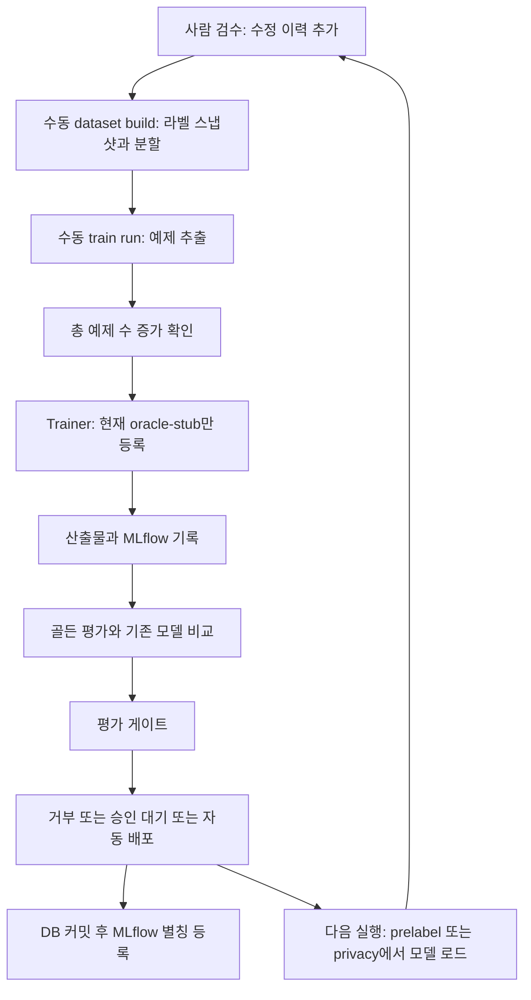

# 학습 루프 구조 검사

[인수인계 첫 화면](README.md) · [남은 과제](known-issues.md)

기준일: **2026-10-10**. 예제 추출·학습·평가·승인·배포·운영 추론 경로를 코드와 대조하고,
분리된 PostgreSQL 테스트 DB와 합성 라벨로 아래 5개 동작을 재현했다.
이번 변경은 검수 문서와 배포 로더의 설명 정정이다. 아래 결함의 실행 로직 수정이나 실제 모델
학습·배포를 수행하지 않았다.

## 판단

**검수 피드백을 저장하고 학습·평가·배포를 연결하는 기반은 있지만, 실제로 성능이 개선되는
학습 루프는 미완성이다.** 등록된 학습기와 로더는 `oracle-stub`뿐이다. 이 stub은 클래스 목록과
설정을 저장하고 평가 정답에서 예측을 만드는 시험 장치다. 영상에서 특징을 학습하지 않는다.
WP13의 완료 기준도 stub으로 흐름을 검사하는 것이므로, 테스트 통과를 실제 재학습 완성으로
해석하면 안 된다.

계약·라벨 이력·분할·평가·배포 잠금은 유지하고, 아래 경계를 단계적으로 보강할 것을 권장한다.
전체 재작성의 근거는 발견하지 않았다. 바디캠 파일럿으로 초안 생성·검수 데이터 수집을 시작하는
것과, 그 데이터로 운영 모델을 개선하는 것은 별도 단계다.

## 현재 흐름



검수 후 데이터셋 생성·학습 실행은 현재 명령 호출이 필요하다. 영속 작업 큐에 의한 자동 실행은
연결되지 않았다. `actions run`은 배포된 행동 모델을 읽지 않는다. `prelabel`은 배포 모델을
못 읽으면 메시지와 함께 기본 어댑터를 사용하고, `privacy`는 `strict=True`로 실패를 전파한다.
따라서 모든 단계에 새 모델이 적용된다고 볼 수 없다.

## 실행으로 재현한 문제

아래의 높음은 실제 학습 루프 제공 전에 해결할 항목, 중간은 경계 보강·평가 재현성 항목이다.
재현 검사 5건의 통과는 **현재 문제 동작을 확인했다는 뜻**이며 결함 해결을 뜻하지 않는다.

| ID / 우선순위 | 재현 결과 | 영향과 코드 근거 |
| --- | --- | --- |
| T1 / 높음 | 기본 `stub_truth=False`로 충분한 예제와 비교 버전을 제공해 실행하면 `ModelUnavailableError`. DB 기록은 롤백되지만 업로드한 stub 산출물은 남음 | 등록 로더가 정답 없이는 동작하지 않는다. CLI는 이 기본값으로 호출한다. 실제 학습기·운영 로더 미구현. [trainers](../../packages/training/src/dlp_train/trainers.py), [CLI](../../packages/cli/src/dlp_cli/train_cmds.py) |
| T2 / 높음 | 기존 라벨 8개를 수정하고 새 데이터셋 버전을 만들었으나 예제 수 24→24. `새 예제 0개 < min_new_examples 5`로 재학습 생략 | 판단이 `n - previous[-1].train_examples`뿐이라 정답 변경을 감지하지 못한다. 직전 거부 모델도 비교 대상이다. `--force`는 수동 우회 수단. [loop:285–298](../../packages/training/src/dlp_train/loop.py) |
| T3 / 높음 | 학습기 실행 중 별도 트랜잭션에서 사용 세션을 철회. 철회 시 연결된 학습 실행은 0건이지만, 이미 읽은 데이터를 이용한 모델은 이후 `DEPLOYED` | 철회 조회는 학습 전 한 번이며 게시 직전 재검사·철회와의 잠금 조정이 없다. 학습 실행 등록도 학습 후라 진행 중 작업을 계보에서 찾지 못한다. [loop](../../packages/training/src/dlp_train/loop.py), [withdraw_session](../../packages/datasets/src/dlp_datasets/lineage.py) |
| T4 / 중간 | 직접 라이브러리 호출로 후보 모델과 `gate.passed=false`, `deployed_baseline=null`인 리포트를 제공하면 최초 배포 성공 | `deploy()`는 후보의 리포트 존재와 비교 모델만 검사하고 게이트 통과·리포트의 후보 ID 일치를 검사하지 않는다. **일반 CLI 실행 경로는 게이트를 먼저 검사하므로, CLI에서 게이트 실패를 바로 우회한다는 판정은 아니다.** [deploy / _compared_with](../../packages/training/src/dlp_train/loop.py) |
| T5 / 중간 | 골든 라벨을 사람이 수정한 뒤 같은 `golden-v1`을 다시 읽으면 정답 라벨 ID 변경 | 골든 버전은 세션 목록을 고정하고 정답은 DB의 현재 라벨로 읽는다. 평가 버전만으로 과거 결과를 재현할 수 없다. 한 실행에서 읽어 둔 후보·배포 모델 비교가 서로 다른 정답을 사용한다는 뜻은 아니다. [golden_sessions](../../packages/evaluation/src/dlp_eval/runner.py) |

T3을 고칠 때 이미 학습에 사용한 데이터를 평가에서만 빼는 것으로 해결하면 안 된다.
철회가 적용된 작업은 게시를 막고, 철회 세션을 제외한 입력으로 다시 학습해야 한다.
확인 시점과 배포 사이의 철회도 막도록 짧은 게시 트랜잭션과 철회 경로의 잠금을 함께 설계한다.

## 추가 구조·운영 한계

다음은 코드 대조로 확인한 설계 제약이다. 위 5개와 별개의 장애 주입 실험을 수행한 항목은 아니다.

- **실제 학습 입력 경계 부족:** `TrainingData`는 라벨·분할·원래 예측을 전달한다. 영상 URI·해시·PTS·
  스트림 동기화 정보를 제공하는 공식 학습용 resolver는 없다. 영상 제공 함수인 `ClipSource`는
  골든 평가에 사용한다. 학습기 객체에 의존성을 주입하는 것은 가능하지만, 공통 미디어 입력·
  감사 경로를 정의해야 한다. [extract](../../packages/training/src/dlp_train/extract.py),
  [Trainer](../../packages/training/src/dlp_train/trainers.py)
- **train/val 사용 규칙 부족:** 두 분할의 예제를 한 목록으로 전달하며 각 예제의 `split`은 보존한다.
  stub은 둘 모두의 클래스 목록을 읽는다. 실제 학습기에서는 `train`만 가중치 갱신에 쓰고 `val`은
  튜닝·검증에 쓰도록 인터페이스와 검사를 보강해야 한다. 실제 모델의 검증 누수가 입증된 것은 아니다.
- **긴 DB 트랜잭션과 부분 실패:** CLI의 `engine.begin()` 안에 외부 MLflow 호출·학습·업로드·평가를
  포함한다. 실패 시 DB 이력은 롤백될 수 있지만 외부 파일·실행은 이미 남는다. 작업 상태를 먼저
  영속화하고, 긴 처리와 짧은 게시를 분리하며 재시도 키·고아 정리·중단 복구를 마련해야 한다.
- **DB와 MLflow 별칭 동기화:** DB 커밋 뒤 별칭을 등록하는 순서는 맞지만, 실패 시 영속 재시도와
  동시 등록의 순서 보장은 없다. 실제 운영 모델 선택의 기준은 DB다. 별칭 전달에는 outbox와
  현재 배포 버전 재확인이 필요하다. 별칭 불일치를 운영 모델 오선택이 재현됐다는 뜻으로 해석하지 않는다.
- **평가·실행 재현성:** 모델 태그는 과제·데이터셋 버전·학습기·파라미터·시각으로 만들고, 학습/평가
  정책 전체·코드 버전·환경·골든 정답 해시를 고정하지 않는다. 입력 manifest와 정책 해시를 함께 남겨야 한다.
- **소표본 배포 판단:** 클래스별 최소 정답 수 부족은 현재 경고이며 배포 차단 조건이 아니다.
  작은 골든셋의 지표 상승을 일반화 성능 향상으로 해석하지 않는다. 실제 목표 과제의 평가 표본과
  승인 조건을 먼저 정해야 한다. [gate](../../packages/evaluation/src/dlp_eval/gate.py)
- **메모리·조회 확장성:** 라벨 스냅샷 전체를 메모리에 읽고 골든 세션별 이력을 조회한다.
  실제 데이터 크기에서 시간을 측정한 뒤 증분 추출·스트리밍·배치 조회를 결정한다. 이번 검사에서
  생산 데이터 규모의 처리량이나 GPU 학습 성능을 측정하지 않았다.

## 유지할 보호 장치

- 라벨은 수정 이력을 추가하며, 승인·수정·표본 검증 및 사람이 만든 예제를 추출한다.
  오류 삽입·측정용 이력은 운영 예제에서 제외한다.
- 학습 라벨은 데이터셋 버전 스냅샷에서 읽는다. 정상 빌드 경로는 작업자·장소 분리를 검사하고,
  학습 실행도 골든 세션 혼입을 검사한다. 골든·holdout은 기본 학습 분할에서 제외한다.
- 후보 예측은 운영 라벨 DB에 넣지 않는다. 대체 모델 최초 배포에는 기존 어댑터의 비교 예측이
  필요하며, 이미 배포된 모델과는 같은 실행에서 골든 평가를 다시 수행한다.
- 개인정보 모델에는 사람 승인을 요구한다. 모델 로딩 시 산출물 sha256을 검사한다.
- 과제별 PostgreSQL 잠금·단일 배포 제약·비교 대상 모델 재확인으로 오래된 비교 결과의 동시
  배포를 막는다. 이번 기존 테스트에서도 동시 최초 배포 중 오래된 비교 기준의 배포 거부를 확인했다.

## 권장 구현 순서와 완료 기준

| 순서 | 작업 | 완료 기준 |
| --- | --- | --- |
| 1 | 한 과제의 실제 학습기·미디어 제공·운영 로더 연결 | 정답을 로더에 주지 않고 새 영상 추론 가능. train/val/golden 분리 검사. 고정된 독립 평가 데이터로 변경 전후 정확도·사람 수정시간 비교 |
| 2 | T2 수정: 예제의 정답 내용·이력 변화로 재학습 판단 | 총 개수 동일한 수정·삭제/추가 교체를 감지. 동일 입력은 중복 실행 방지. 거부 작업 재시도 정책을 명시 |
| 3 | T3 및 영속 실행 상태: 철회와 게시 조정 | 입력 읽기 후·학습 중·평가 후·승인 직전 철회 모두 게시 거부. 이미 배포된 관련 모델의 처리도 명시. 장애 후 실행 상태 조회·안전한 재시도 |
| 4 | T4/T5: 배포 경계 검증과 골든 입력 고정 | 직접 배포 호출도 게이트 실패·다른 후보 리포트 거부. 같은 평가 입력 버전은 정답·미디어 해시가 불변. 정답 수정은 새 버전 |
| 5 | 짧은 트랜잭션·작업 재개·별칭 전달·확장성 개선 | 실패 후 DB/저장소/MLflow 대조 및 재시도. 병렬 실행 후 실제 배포와 별칭 일치. 목표 규모에서 시간·메모리·비용 측정 |

실제 모델을 서비스에 제공하기 전에는 T2/T3도 완료해야 한다. 1번만 연결해 자동 배포를 켜지 않는다.
새 계약·DB 필드가 필요하면 ADR·마이그레이션·계약 검사·생성 스키마를 함께 바꾼다.

## 검증 기록과 범위

기본 정책 선택을 사용하도록 `DLP_REVIEW_POLICY_FILE`을 해제하고 현재 클라우드 환경에서 검사했다.

- 기존 학습·평가·동시 최초 배포 검사: **97 passed** (9.14초).
- 구조 문제 재현: **5 passed** (2.65초). 임시 테스트를 저장소 밖에서 수집해 `services` 마커
  미등록 경고 1건 발생; 테스트는 모두 실행됐다. 재현 코드·로그는 현재 환경의
  `/workspace/.cloud-onboarding/data-labeling/training-loop-review-2026-10-10/`에 보관했다.
- 기존 검사 명령:

  ```bash
  uv run pytest -o addopts='' packages/training/tests packages/evaluation/tests \
    tests/test_review_regressions.py::test_concurrent_first_deployment_rejects_stale_baseline
  ```

재현은 합성 라벨·시험용 학습기를 사용했다. 실제 고객 영상·GPU 재학습·성능 개선·장기 운영은
이 검사에 포함하지 않는다. 이전 전체 검사 결과는 [남은 과제](known-issues.md)에 있으며,
이번에는 실행 로직 변경 없이 관련 테스트를 다시 실행했다. 배포 로더의 모듈 설명에는
`strict=False` 기본 동작과 프라이버시 CLI의 `strict=True` 동작을 구분해 적었다.
