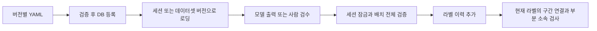

# 온톨로지 이해·확장·검수 안내

이 문서는 **1.0.0 초안을 읽는 개발자와 현장 전문가의 공통 안내**다. 아래 판단 기준은 검수를
시작하기 위한 설명 초안이며 현장 확정본이 아니다. YAML의 ID·허용 값은 바꾸지 않았다.
현장 영상의 경계 사례로 기준을 조정한 뒤, 의미 변경이 필요하면 새 온톨로지 버전을 만든다.

## 구조와 코드의 책임



| 바꾸려는 것 | 먼저 볼 파일 |
| --- | --- |
| 허용 ID·도구·상태·작업 목록 | [온톨로지 YAML](../config/ontology/v1/), [타입·교차 참조](../packages/schema/src/dlp_schema/ontology.py) |
| 세션·데이터셋 사전 선택 | [DB 공통 로더](../packages/schema/src/dlp_schema/db/ontology_repository.py), [CLI 연결](../packages/cli/src/dlp_cli/ontology_access.py) |
| 저장 시 허용/거부 규칙 | [순수 배치 검증](../packages/schema/src/dlp_schema/label_validation.py), [사전 의미 검사](../packages/schema/src/dlp_schema/validation.py) |
| 상위 구간의 자식 연결 | [구간 참조 검사](../packages/schema/src/dlp_schema/label_graph.py), [에피소드 계약](../packages/schema/src/dlp_schema/episode.py) |
| 버전 간 ID 변경 | [이관](../packages/schema/src/dlp_schema/migration.py) |
| 검수 화면의 사전 분리 | [프로젝트 이름](../packages/review/src/dlp_review/ontology_projects.py) |

`primitive`는 행동 라벨, `skill`·`human_skill`은 상위 구간이다. 업무는 도메인→작업→하위 단계로
분류한다. 현재 작업 하위 단계는 0개이며 기술과 원시 동작의 조합을 자동으로 생성하는 경로는 없다.
현재 구조·항목 수는 [구조 검사](handover/ontology-structure-review.md)에 있다.

## 원시 동작의 검수 기준 초안

| ID / 이름 | 포함할 사례 | 구분·제외할 사례 |
| --- | --- | --- |
| grasp / 잡다 | 손이 대상에 접근해 파지를 형성 | 이미 쥔 채 유지하는 구간, 단순 접촉 |
| release / 놓다 | 유지하던 파지를 해제 | 파지 실패·의도하지 않은 낙하는 이벤트도 검토 |
| lift / 들어 올리다 | 대상이 위쪽으로 이동 | 카메라 움직임만으로 위로 보이는 경우 |
| lower / 내리다 | 대상을 아래쪽으로 이동 | 단순 파지 해제만 보이는 경우 |
| carry / 옮기다 | 들고 위치를 바꾸는 이동 | 제자리에서 높이만 바꾸는 lift/lower |
| push / 밀다 | 힘을 가해 대상이 손에서 멀어지는 이동 | 표면을 반복 마찰하는 rub과 구분 |
| pull / 당기다 | 힘을 가해 대상이 손 쪽으로 이동 | 카메라 접근에 따른 상대 이동 |
| rotate / 돌리다 | 대상의 방향·각도를 바꾸는 회전 | 카메라 회전만 관찰되는 경우 |
| press / 누르다 | 버튼·표면 등을 눌러 힘을 가함 | 힘이나 결과를 확인할 수 없는 단순 접촉 |
| rub / 문지르다 | 접촉을 유지하며 상대 표면을 마찰 | 업무 목적이 닦기라는 이유만으로 모든 접촉에 부여하지 않음 |
| support / 지지하다 | 손이 대상의 안정·하중을 보조 | 가까이 있지만 접촉·지지 근거가 없는 경우 |

힘·의도·접촉은 영상만으로 확정하기 어려울 수 있다. 판단할 수 없는 행동 구간은 `unknown`을
사용하고 이유를 기록한다. `idle`은 의도적 정지, `out_of_scope`는 대화·기록 등 조작 범위 밖
활동이다. 가림으로 판단이 불가능한 구간을 대기로 단정하지 않는다.

## 청소에서 혼동하기 쉬운 용어

| 항목 | 기준 초안 |
| --- | --- |
| rub와 wipe | rub는 원시 동작, wipe는 닦기 기술 구간이다. 현재 행동 VLM은 wipe를 출력하지 않음 |
| 객체와 도구 | 도구는 작용부·파지부를 정의한 객체다. 도구 목록에 없는 객체를 임의로 도구로 판정하지 않음 |
| handle | 여러 도구가 공유하는 부분 이름이다. 반드시 개체 ID와 해당 도구 클래스를 함께 해석 |
| surface | 처리 대상 표면이라는 분류다. 그 표면이 청결하다는 판정이 아님 |
| clean / dirty | 오염의 관찰·확인 기준을 현장에서 정해야 함. 보이지 않는 영역이나 소독 효과까지 단정하지 않음 |
| wet / dry | 관찰 또는 확인 근거가 있는 상태만 기록. 반사광만으로 젖음을 확정하지 않음 |
| rework_missed_area | 미처리 영역을 다시 처리한 사건. 단순 반복 닦기와 구분할 근거 필요 |

예를 들어 표면 청소 영상에서 `잡다 → 문지르다 → 놓다`를 관찰하고, 전문가가 이를 `닦다` 기술로
묶을 수 있다. 상위 구간의 `child_ids`는 그 행동의 `action_id`를 참조한다. `label_id`는
수정 이력의 레코드 ID이므로 자식 ID로 사용하지 않는다. 행동을 수정해도 action_id를 유지하면
상위 구간 연결을 보존할 수 있다. 행동 자체를 제거하면 참조하는 구간도 같은 배치에서 정리한다.

## 실제 영상 예시를 채우는 형식

아직 검수된 현장 예시 영상은 이 문서에 없다. 개인정보 검수를 마친 접근 가능한 영상에 대해
아래 기록을 전문가가 채운다. 영상이나 원본 URI를 공개 저장소에 넣지 않는다.

| 항목 | 기록 내용 |
| --- | --- |
| 영상·시각 | 검수용 영상의 내부 ID, 시작·종료 ms, 공간 라벨이면 해당 스트림 PTS |
| 용어 | 온톨로지 버전과 ID, 원시 동작/기술/업무 수준 |
| 포함 근거 | 영상에서 직접 확인한 접촉·이동·상태 변화 |
| 경계 사례 | 비슷하지만 다른 용어인 사례와 구분 이유 |
| 불확실성 | 가림·영상 품질·센서 부재, 재검수 필요 여부 |
| 확인 | 현장 전문가·확인일·합의된 판단 기준 |

## 변경과 운영 절차

1. 읽기 전용으로 `dlp ontology audit`를 실행해 현재 운영 라벨을 확인한다.
   한 세션은 `dlp ontology audit --session <세션 ID>`로 제한할 수 있다.
2. 새 ID 추가도 파일럿 용어 기준과 대표 사례를 먼저 기록한다. 기존 ID의 의미를 바꾸지 않는다.
   draft의 덧붙이기 외 변경은 새 버전·이관 표가 필요하다.
3. 새 사전을 `dlp ontology validate`, `dlp ontology register <버전>`으로 검증·등록한다.
   이관 함수에는 `target_ontology=`를 반드시 제공한다. `needs_review`를 무시하지 않는다.
   자식이 빠져 구간 연결이 깨진 이관 배치는 상위 구간만 저장하지 않고 다시 검수한다.
4. 이관의 세션 버전 전환·새 라벨 저장은 별도 실행 설계가 필요하다. 현재 자동 이관 CLI는 없다.
   골든셋과 검수 작업의 재검수도 함께 계획한다.
5. 검수 프로젝트는 사전 버전·내용 해시별로 새로 생성된다. 기존 작업은 유지된다.
   새 프로젝트를 만든 뒤 `dlp review register-webhooks <접근 가능한 수집 URL>`을 실행한다.
6. 새 계약·DB 변경에는 ADR·Alembic·계약 검사·`make schemas`를 함께 적용하고 전체 검사를 돌린다.

신규 비삭제 라벨의 세션 버전은 Alembic 0014부터 직접 SQL INSERT에서도 검사한다.
사전 의미는 공통 저장 함수가 검사하므로 테이블에 직접 쓰는 애플리케이션 경로를 추가하지 않는다.
클래스가 알려지지 않은 개체의 부분은 전체 ID만 검사할 수 있다. 개체별 부분 소속 확인에는 명시적 개체
목록으로 `validate_episode`를 호출한다. 구현 이유는 [ADR 0037](adr/0037-ontology-validation-boundaries.md)에 있다.

## 회귀 검사 위치

[test_ontology_boundaries.py](../packages/schema/tests/test_ontology_boundaries.py)는 잘못된 값의
배치 전체 거부, 버전별 로딩·직접 SQL 버전 거부, 삭제 이력·QA 오류 보존, 구간의 자식·시간·
순환·수정, 작업 소속·부분 소속, 이관 목적지와 빠진 자식, 검수 화면 분리·읽기 전용 감사를 검사한다.
PostgreSQL이 준비된 개발 환경에서 아래 명령으로 단위/서비스 표시를 모두 실행한다.

```bash
uv run pytest --import-mode=importlib -o addopts='' packages/schema/tests/test_ontology_boundaries.py
```

이 검사에는 합성 라벨과 시험용 DB를 사용한다. 실제 영상의 용어 적합성·검수자 일치도는 현장
예시 기록과 별도의 품질 검사로 확인한다.

2026-10-11 검증: 경계 회귀 19건, 전체 기본 검사 501건, 서비스 통합 120건 통과.
경계 회귀는 기본/서비스 검사와 일부 중복이다. 깊이 실제 모델 1건은 생략했으며,
자세한 범위와 개발 DB 적용 기록은 [검증 결과](handover/known-issues.md)에 남겼다.
